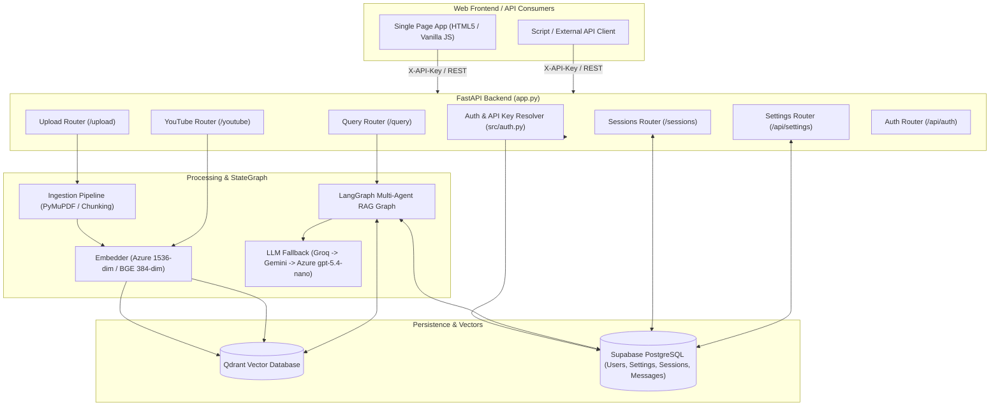

# 🌪️ DocuVortex: Intelligent Multi-Modal RAG & Agentic Document Intelligence

[](https://www.python.org/downloads/)
[](https://fastapi.tiangolo.com)
[](https://python.langchain.com)
[](https://langchain-ai.github.io/langgraph/)
[](https://qdrant.tech/)
[](https://supabase.com/)
[](LICENSE)

**DocuVortex** is an enterprise-grade, agentic Retrieval-Augmented Generation (RAG) platform designed to converse with diverse document collections and YouTube video transcripts with zero hallucination, verifiable citations, persistent chat memory, and multi-tier model fallbacks.

Built on **LangGraph state machines**, **Qdrant vector databases**, and **Supabase PostgreSQL**, DocuVortex transforms raw unstructured data into an interactive, multi-turn AI workspace.

---

## 🌟 Key Features

- 📄 **Multi-Format Document Ingestion:** Native parsing and chunking for PDF, DOCX, TXT, CSV, XLSX, and Markdown documents.
- 🎥 **YouTube Video Intelligence:** Ingests YouTube URLs, retrieves accurate transcripts with timestamps, and enables conversational video analysis.
- 🧠 **Agentic LangGraph Workflow:** Query rewriting, adaptive retrieval, context compression, hallucination verification, and strict citation grounding.
- 🛡️ **3-Tier LLM Generation Fallback:** Automatic zero-downtime generation routing:
  $$\text{All Groq Models} \longrightarrow \text{All Gemini Models} \longrightarrow \text{Azure OpenAI } \texttt{gpt-5.4-nano}$$
- ⚡ **Multi-Provider Embeddings & Strict Consistency:**
  - **Primary:** Azure OpenAI `text-embedding-3-small` (1536 dims) with fail-fast resilience (`ResilientAzureEmbeddings`).
  - **Fallback:** Local `BAAI/bge-small-en-v1.5` (384 dims) loaded lazily only when selected by the user.
  - **Per-Collection Consistency:** Collections are audited against active vector dimensions; incompatible documents display a `"Needs re-index"` warning badge.
- ⚙️ **Workspace Settings UI:** In-app settings modal allowing instant switching between Azure OpenAI and local HuggingFace embeddings.
- 🔑 **Frictionless Authentication:** API-key-first authentication generated directly on the landing page UI or via CLI (`seed_user.py`), cached in localStorage, and transmitted via `X-API-Key` headers. Includes guest mode for instant exploration.
- 💾 **Stateful Conversational Memory:** Multi-turn session persistence backed by Supabase PostgreSQL `AsyncPostgresSaver` checkpointer, sliding context windows, and automatic background session summarization.

---

## 🏗️ System Architecture



---

## 📂 Project Structure

```text
├── app.py                      # FastAPI application entrypoint & lifespan lifecycle
├── seed_user.py                # CLI script to generate users & dk_live_... API keys
├── check_db.py                 # Diagnostic database connection & statistics tool
├── wipe_data.py                # Safe development data cleanup script
├── requirements.txt            # Python dependencies
├── .env.example                # Sample environment configuration
│
├── config/
│   └── config.yaml             # Model, chunking, and database defaults
│
├── database/
│   └── init.sql                # PostgreSQL relational schema for Supabase
│
├── src/
│   ├── auth.py                 # API key hash verification & JWT utilities
│   ├── logger.py               # Centralized rotating file & console logger
│   ├── exception.py            # Custom exception wrapper with traceback details
│   │
│   ├── chains/
│   │   └── qa_chain.py         # Grounded QA chain & _build_llm() fallback hierarchy
│   │
│   ├── components/
│   │   ├── embedder.py         # Multi-provider embedder (Azure & BGE lazy singleton)
│   │   ├── ingestion.py        # Document text extraction & semantic chunking
│   │   ├── memory_manager.py   # Multi-turn history, attachments, & dimension checks
│   │   └── vector_store.py     # Qdrant client connection & dimension guard
│   │
│   ├── database/
│   │   └── db.py               # psycopg2 threaded connection pool manager
│   │
│   ├── graph/
│   │   ├── builder.py          # LangGraph StateGraph definition & compiled graph
│   │   ├── nodes.py            # Graph execution nodes (retrieve, generate, rewrite)
│   │   └── state.py            # RAGState TypedDict state schema
│   │
│   ├── routers/
│   │   ├── auth.py             # /api/auth routes
│   │   ├── settings.py         # /api/settings routes (embedding provider toggle)
│   │   ├── collections.py      # Vector collection management endpoints
│   │   ├── health.py           # System liveness & readiness checks
│   │   ├── pages.py            # HTML template rendering (/app, /landing)
│   │   ├── query.py            # LangGraph RAG conversational query endpoint
│   │   ├── sessions.py         # Chat session listing, history, & deletion
│   │   ├── upload.py           # Document upload & ingestion endpoint
│   │   └── youtube.py          # YouTube video transcription & indexing
│   │
│   └── utils/
│       └── helpers.py          # Template readers & sanitization helpers
│
├── templates/
│   ├── home.html               # Main workspace SPA interface & Settings modal
│   ├── index.html              # Landing page
│   └── static/
│       ├── css/                # Design stylesheets
│       └── js/                 # Vanilla JS app logic (app_new.js)
```

---

## 📡 API Reference Overview

| Method | Endpoint | Description |
| :--- | :--- | :--- |
| `GET` | `/app` | Main single-page interactive chat interface |
| `GET` | `/api/settings/embedding` | Get active provider & available model metadata |
| `POST` | `/api/settings/embedding` | Switch user's active embedding provider (`azure` or `bge`) |
| `POST` | `/api/auth/create-key` | In-browser API key generation and identity rotation |
| `POST` | `/api/auth/verify-key` | Validate API key and issue 30-day session token |
| `GET` | `/api/auth/session-status` | Check authentication status & retrieve active session ID |
| `POST` | `/api/auth/logout` | Revoke session and delete session cookie |
| `POST` | `/upload` | Ingest and embed PDF, DOCX, TXT, CSV, JSON files |
| `POST` | `/youtube` | Ingest, transcribe, and index YouTube video content |
| `POST` | `/query` | Execute LangGraph conversational RAG query (SSE stream) |
| `GET` | `/sessions` | List all chat sessions for the authenticated user |
| `GET` | `/sessions/{id}` | Retrieve full message history, citations, and attachment audit |
| `DELETE`| `/sessions/{id}` | Permanently delete a chat session and associated metadata |
| `GET` | `/health` | Check PostgreSQL pool and vector store health |

---

## 📄 License

This project is licensed under the MIT License - see the [LICENSE](LICENSE) file for details.
